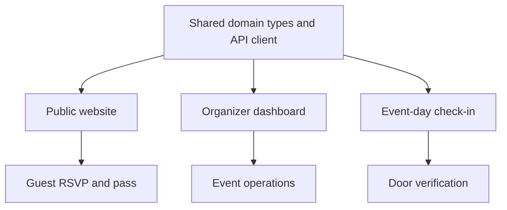

# Frontend architecture

## Product boundary

NASA EVENT is one product with three experiences, not one dashboard wearing three skins.



The modules share typed records and visual tokens. They do not share navigation or authorization state.

## Module responsibilities

| Module | Owns | Must not expose |
| --- | --- | --- |
| Public website | Published events, organizer portfolios, RSVP collection, guest confirmation/pass, product/help/legal pages | Draft events, private guest lists, team details, internal analytics |
| Organizer dashboard | Organizer account, event lifecycle, guests, seating, messaging, check-in configuration, analytics, team permissions, public portfolio | Raw staff credentials, other organizers' tenants, scanner-only shortcuts |
| Event-day check-in | Assigned events, pass verification, minimal guest/seating detail, manual lookup, cached roster, sync state | Event editing, messaging, billing, unrelated events, broad account settings |

## State model

The current build has three state classes:

1. **Static mock records** in `lib/data/mock-data.ts` for repeatable page rendering.
2. **Ephemeral component state** for filters, forms, seating interactions, scan outcomes, and success notices.
3. **Device-local demo state** in `localStorage` for organizer/check-in sessions, guest pass data, and theme choice.

The third class is a prototype convenience only. A production backend should move identity, permissions, guest state, and check-ins to server-owned storage. Theme choice may remain cached locally after it is also stored against the user profile.

## Backend replacement seam

`NasaEventClient` in `lib/services/nasa-client.ts` is the read boundary. Keep its typed return values stable while replacing the implementation:

```ts
const apiClient: NasaEventClient = {
  async listPublishedEvents() {
    return fetch("/api/events", { cache: "no-store" }).then((response) => response.json());
  },
  // Implement remaining methods with the same return types.
};
```

For writes, create server actions or an authenticated API layer and call them from the existing submit/check-in handlers. Do not put secrets or privileged database access in client components.

## Suggested ownership rules

- Public event and organizer reads are anonymous and return only published fields.
- Organizer routes require an organizer session and an active workspace membership.
- Every organizer mutation is scoped by both `workspaceId` and `eventId` on the server; never trust route parameters alone.
- Check-in sessions are short-lived, restricted to explicitly assigned events, and carry a staff role.
- Check-in creation is atomic and idempotent by pass/event pair.
- Supervisor overrides and reversals require a reason and an audit entry.
- Offline mutations carry a device-generated operation ID so replay does not create duplicate entries.

## Design system

The UI is driven by CSS custom properties in `app/globals.css`. `ThemeProvider` applies a workspace accent and light/dark preference without changing semantic status colors. Violet is the default accent; coral, teal, gold, and green are available alternatives.

The scanner keeps higher contrast, larger touch targets, and fewer actions than the dashboard because it is designed for a busy entrance and tablet use.
